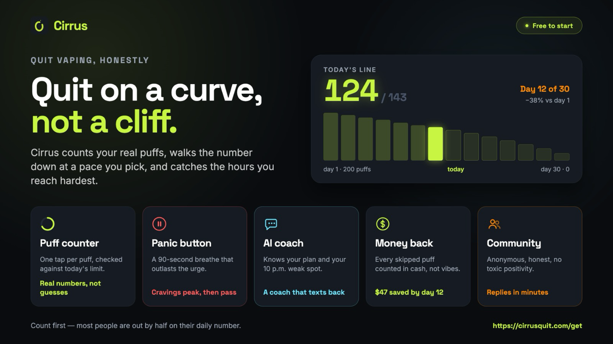

In April 2023 the UK government said it would offer a free vape starter kit to a million
smokers in England. In the US, the FDA has not approved a single e-cigarette as a way to quit.

Same device, opposite verdicts. Neither side is being careless. They're answering two different
questions.

## The short answer

Yes. A nicotine vape helps more smokers quit than patches or gum do, and that's about as firm
as this field gets.

It comes with two conditions. The vape has to replace cigarettes rather than keep them company,
and it works best with some support around it.

Then there's the catch. Most people who quit this way are still vaping a year later.

## What the trials found

Cochrane keeps a living review of e-cigarettes for quitting smoking. The August 2026 version
pools 80 randomised trials and 29,861 people.

Out of every 100 smokers who try to quit with a nicotine vape, 8 to 10 are still off cigarettes
six months on. With patches or gum it's 6. With counselling alone, or no help at all, it's 5.
Cochrane grades the patches and gum comparison high-certainty, the top of its scale.

The best-known single trial, published in 2019, ran inside NHS stop-smoking services. It gave
886 smokers either a refillable vape or the nicotine replacement of their choice, with weekly
support for at least four weeks. After a year, 18% of the vape group weren't smoking,
against 9.9% of the rest.

Look at those figures again, though. Even in the group that did best, more than eight in ten
hadn't quit. A vape improves your odds. It doesn't make this easy, and anyone who says it does
is probably selling one.

## Why it looks worse outside a trial

This is where the American caution comes from.

Researchers at UC San Diego followed 6,013 US smokers from 2017 to 2021. Nobody handed them
anything. Some just vaped. On the raw numbers the daily vapers looked
ahead, but once they were matched with similar smokers on 14 things, including income, age and
how much they wanted to quit, the lead vanished. Occasional vapers did worse: 5.3 percentage
points less likely to have stopped smoking.

The World Health Organization reads it the same way. In 2023 it said e-cigarettes "as consumer
products are not shown to be effective for quitting tobacco use at the population level".

"As consumer products" is carrying a lot there. In a trial you're given a device, you've set a
quit date, and someone checks in for weeks. At a petrol station you buy a disposable and keep
smoking around it. The trials measure the first. Surveys mostly catch the second.

It's also why the US Preventive Services Task Force called the evidence insufficient in 2021, in
a statement it's now updating.

## The catch: you'll probably still be vaping

Back to that NHS trial. Of the people who had quit smoking at one year, 80% in the vape group
were still vaping. In the other group, 9% were still on patches or gum.

A 2024 Swiss trial of 1,246 smokers shows it from another angle.
Adding free vapes to counselling lifted the six-month quit rate from 16.3% to 28.9%. But only
20.1% of the vape group were off nicotine altogether, against 33.7% of the group without one.
The university put it in its own headline:

> Vapes help to stop smoking, but not necessarily stop using nicotine.
>
> <cite>University of Bern, on the ESTxENDS trial, 2024</cite>

For a smoker that's still a good trade, because
[a vape is the less harmful of the two](/blog/is-vaping-worse-than-smoking). It is a trade,
though. You haven't left nicotine, you've changed how it gets in. The NHS is plain about it: if
you're vaping to quit smoking, you should aim to stop vaping eventually too.

## Vaping and still smoking

The tempting version is the halfway one: fewer cigarettes, plus a vape.

It feels like progress, and the data is unkind to it. Those occasional vapers in the San Diego
study were the ones who fell behind. And among 24,000 US adults followed from 2013 to 2019,
people who smoked and vaped were no less likely to have a heart attack, stroke or heart failure
than people who only smoked.

The benefit turns up when the cigarettes stop. All of them.

## If you're going to try it

Pick a day and make it a clean switch. From that morning the cigarettes are gone, not rationed.

Get some help. In England, local Stop Smoking Services exist for exactly this. In the US, the
FDA has approved seven medicines for quitting smoking, and a doctor or pharmacist can walk you
through them.

And decide now when the vape goes. The CDC tells anyone quitting this way to make a plan to quit
vaping as well. That plan is easier to write on day one than in month eight, when the vape has
become the habit.

If you don't smoke, none of this is for you. The NHS says children and non-smokers should never
vape.

## Where Cirrus fits

<figure>

<figcaption>Illustration only. The card shows a taper. The app runs cold turkey too.</figcaption>
</figure>

Full disclosure: [Cirrus](/) is our app, and it won't get you off cigarettes. It's for the
second half of the job, the vape you're left holding once they're gone.

It counts the puffs you actually take, so you start from a real number and not a guess. It steps
that number down on a curve, and when a craving lands there's a panic button and a breathing
pacer.

One honest caveat: the research on quitting vaping is much thinner than on quitting smoking.
Cochrane calls it promising but low-certainty, so ask a doctor or pharmacist about medication.
We covered [what works best so far](/blog/most-effective-way-to-quit-vaping).

**[Get Cirrus, free to start](/download)**, on iPhone or Android.

## So, does vaping help people quit smoking?

It does, and better than patches or gum, as long as you switch completely and don't go it alone.

Just know what you're signing up for. The cigarette is the first thing you quit. The vape is the
second, and nobody mentions that one at the counter.
