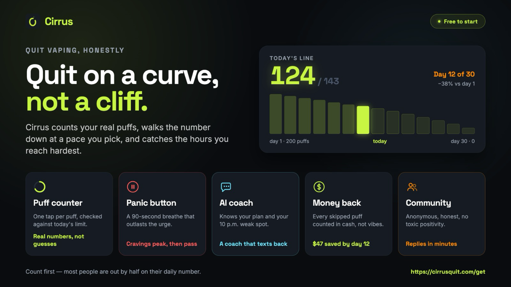

Quitting a vape isn't one big decision. It's the same small one, made every time your hand goes
to your pocket.

Cirrus is built around those small moments. Full disclosure: [Cirrus](/) is our app. Here's how
it works, in four simple charts.

## The short answer

Tell the app how you vape. It sets a daily puff limit that drops to zero by a date you can see, or
starts you at zero if you'd rather go cold turkey. You tap once for every puff. When a craving
hits, you open the app instead of the vape. If you slip, you carry on tomorrow.

## How we built it

Four rules, each one taken from the research.

**Count every puff.** Cirrus can't see your vape, so you tap. That's the point: across 138
studies, keeping track of progress helped people reach their goals, and writing it down helped
most.

**Let people choose.** In 22 trials with smokers, cutting down and stopping in one go worked
about as well as each other. So you pick.

**Help in the worst minutes.** A craving usually passes in 15 to 20 minutes. The panic button is
built for exactly that window.

**Never start over.** A slip costs you a day, not the plan.

## 1. Your journey

<figure class="fc"><svg class="fc-h" viewBox="0 0 680 58" role="img" aria-label="Take the quiz, see your plan, hold to commit, log each day, reach Freedom Day."><defs><marker id="fc1h" viewBox="0 0 10 10" refX="9" refY="5" markerWidth="7" markerHeight="7" orient="auto-start-reverse"><path d="M0 0L10 5L0 10z" fill="#9aa3b2"/></marker></defs><g class="fc-volt"><rect class="fc-end" x="1" y="2" width="108" height="54" rx="27"/><text class="fc-l" x="55" y="20.5" text-anchor="middle">Take the</text><text class="fc-l" x="55" y="37.5" text-anchor="middle">quiz</text></g><g class="fc-volt"><rect class="fc-box" x="143.5" y="2" width="108" height="54" rx="6"/><text class="fc-l" x="197.5" y="20.5" text-anchor="middle">See your</text><text class="fc-l" x="197.5" y="37.5" text-anchor="middle">plan</text></g><path class="fc-line" d="M109 29 L141.5 29" marker-end="url(#fc1h)"/><g class="fc-volt"><rect class="fc-box" x="286" y="2" width="108" height="54" rx="6"/><text class="fc-l" x="340" y="20.5" text-anchor="middle">Hold to</text><text class="fc-l" x="340" y="37.5" text-anchor="middle">commit</text></g><path class="fc-line" d="M251.5 29 L284 29" marker-end="url(#fc1h)"/><g class="fc-volt"><rect class="fc-box" x="428.5" y="2" width="108" height="54" rx="6"/><text class="fc-l" x="482.5" y="20.5" text-anchor="middle">Log each</text><text class="fc-l" x="482.5" y="37.5" text-anchor="middle">day</text></g><path class="fc-line" d="M394 29 L426.5 29" marker-end="url(#fc1h)"/><g class="fc-volt"><rect class="fc-end" x="571" y="2" width="108" height="54" rx="27"/><text class="fc-l" x="625" y="20.5" text-anchor="middle">Freedom</text><text class="fc-l" x="625" y="37.5" text-anchor="middle">Day</text></g><path class="fc-line" d="M536.5 29 L569 29" marker-end="url(#fc1h)"/></svg><svg class="fc-v" viewBox="0 0 300 335" role="img" aria-label="Take the quiz, see your plan, hold to commit, log each day, reach Freedom Day."><defs><marker id="fc1v" viewBox="0 0 10 10" refX="9" refY="5" markerWidth="7" markerHeight="7" orient="auto-start-reverse"><path d="M0 0L10 5L0 10z" fill="#9aa3b2"/></marker></defs><g class="fc-volt"><rect class="fc-end" x="50" y="1" width="200" height="44" rx="22"/><text class="fc-l" x="150" y="23" text-anchor="middle">Take the quiz</text></g><g class="fc-volt"><rect class="fc-box" x="50" y="73" width="200" height="44" rx="6"/><text class="fc-l" x="150" y="95" text-anchor="middle">See your plan</text></g><path class="fc-line" d="M150 45 L150 71" marker-end="url(#fc1v)"/><g class="fc-volt"><rect class="fc-box" x="50" y="145" width="200" height="44" rx="6"/><text class="fc-l" x="150" y="167" text-anchor="middle">Hold to commit</text></g><path class="fc-line" d="M150 117 L150 143" marker-end="url(#fc1v)"/><g class="fc-volt"><rect class="fc-box" x="50" y="217" width="200" height="44" rx="6"/><text class="fc-l" x="150" y="239" text-anchor="middle">Log each day</text></g><path class="fc-line" d="M150 189 L150 215" marker-end="url(#fc1v)"/><g class="fc-volt"><rect class="fc-end" x="50" y="289" width="200" height="44" rx="22"/><text class="fc-l" x="150" y="311" text-anchor="middle">Freedom Day</text></g><path class="fc-line" d="M150 261 L150 287" marker-end="url(#fc1v)"/></svg><figcaption>Your journey, start to finish. Go cold turkey and your limit starts at zero.</figcaption></figure>

The quiz takes a few minutes and has no paywall. It asks how much you vape, what it costs and why
you want out. Then it shows your plan and the day it ends, which we call Freedom Day.

## 2. A normal day

<figure class="fc"><svg class="fc-h" viewBox="0 0 680 112" role="img" aria-label="A craving or a reminder, then tap to log, see it count, check in. The next day starts again with a lower limit."><defs><marker id="fc2h" viewBox="0 0 10 10" refX="9" refY="5" markerWidth="7" markerHeight="7" orient="auto-start-reverse"><path d="M0 0L10 5L0 10z" fill="#9aa3b2"/></marker></defs><g class="fc-volt"><rect class="fc-box" x="1" y="2" width="132" height="54" rx="6"/><text class="fc-l" x="67" y="20.5" text-anchor="middle">Craving or</text><text class="fc-l" x="67" y="37.5" text-anchor="middle">reminder</text></g><g class="fc-volt"><rect class="fc-box" x="183" y="2" width="132" height="54" rx="6"/><text class="fc-l" x="249" y="29" text-anchor="middle">Tap to log</text></g><path class="fc-line" d="M133 29 L181 29" marker-end="url(#fc2h)"/><g class="fc-volt"><rect class="fc-box" x="365" y="2" width="132" height="54" rx="6"/><text class="fc-l" x="431" y="29" text-anchor="middle">See it count</text></g><path class="fc-line" d="M315 29 L363 29" marker-end="url(#fc2h)"/><g class="fc-volt"><rect class="fc-box" x="547" y="2" width="132" height="54" rx="6"/><text class="fc-l" x="613" y="29" text-anchor="middle">Check in</text></g><path class="fc-line" d="M497 29 L545 29" marker-end="url(#fc2h)"/><path class="fc-line" d="M613 56 L613 84 L67 84 L67 58" marker-end="url(#fc2h)"/><text class="fc-s fc-s--volt" x="340" y="100" text-anchor="middle">Next day, a lower limit</text></svg><svg class="fc-v" viewBox="0 0 320 263" role="img" aria-label="A craving or a reminder, then tap to log, see it count, check in. The next day starts again with a lower limit."><defs><marker id="fc2v" viewBox="0 0 10 10" refX="9" refY="5" markerWidth="7" markerHeight="7" orient="auto-start-reverse"><path d="M0 0L10 5L0 10z" fill="#9aa3b2"/></marker></defs><g class="fc-volt"><rect class="fc-box" x="40" y="1" width="200" height="44" rx="6"/><text class="fc-l" x="140" y="23" text-anchor="middle">Craving or reminder</text></g><g class="fc-volt"><rect class="fc-box" x="40" y="73" width="200" height="44" rx="6"/><text class="fc-l" x="140" y="95" text-anchor="middle">Tap to log</text></g><path class="fc-line" d="M140 45 L140 71" marker-end="url(#fc2v)"/><g class="fc-volt"><rect class="fc-box" x="40" y="145" width="200" height="44" rx="6"/><text class="fc-l" x="140" y="167" text-anchor="middle">See it count</text></g><path class="fc-line" d="M140 117 L140 143" marker-end="url(#fc2v)"/><g class="fc-volt"><rect class="fc-box" x="40" y="217" width="200" height="44" rx="6"/><text class="fc-l" x="140" y="239" text-anchor="middle">Check in</text></g><path class="fc-line" d="M140 189 L140 215" marker-end="url(#fc2v)"/><path class="fc-line" d="M240 239 L284 239 L284 23 L242 23" marker-end="url(#fc2v)"/><text class="fc-s fc-s--volt" x="302" y="131" text-anchor="middle" transform="rotate(90 302 131)">Next day, a lower limit</text></svg><figcaption>The loop you go round every day.</figcaption></figure>

Nothing here takes more than a tap or two. Pick your hardest hour and you get a reminder ten
minutes before it. Each evening the app checks in on how your day went.

That daily support matters. In two trials with 4,091 young people, a text programme helped 29 in
100 quit vaping, against 22 with little or no support. It wasn't our app, and Cochrane rates the
evidence as low certainty, but it's the kind of help that has been tested.

## 3. When a craving hits

<figure class="fc"><svg class="fc-h" viewBox="0 0 680 202" role="img" aria-label="A craving hits: press panic, breathe, then play a game, post an SOS or talk to your coach. Has it passed? If not, go again. If yes, the craving is beaten."><defs><marker id="fc3h" viewBox="0 0 10 10" refX="9" refY="5" markerWidth="7" markerHeight="7" orient="auto-start-reverse"><path d="M0 0L10 5L0 10z" fill="#9aa3b2"/></marker></defs><g class="fc-oxy"><rect class="fc-end" x="1" y="57" width="96" height="54" rx="27"/><text class="fc-l" x="49" y="84" text-anchor="middle">Craving</text></g><g class="fc-oxy"><rect class="fc-box" x="138.5" y="57" width="100" height="54" rx="6"/><text class="fc-l" x="188.5" y="75.5" text-anchor="middle">Press</text><text class="fc-l" x="188.5" y="92.5" text-anchor="middle">panic</text></g><path class="fc-line" d="M97 84 L136.5 84" marker-end="url(#fc3h)"/><g class="fc-oxy"><rect class="fc-box" x="280" y="57" width="100" height="54" rx="6"/><text class="fc-l" x="330" y="84" text-anchor="middle">Breathe</text></g><path class="fc-line" d="M238.5 84 L278 84" marker-end="url(#fc3h)"/><g class="fc-oxy"><rect class="fc-box" x="421.5" y="57" width="112" height="54" rx="6"/><text class="fc-l" x="477.5" y="75.5" text-anchor="middle">Game, SOS</text><text class="fc-l" x="477.5" y="92.5" text-anchor="middle">or coach</text></g><path class="fc-line" d="M380 84 L419.5 84" marker-end="url(#fc3h)"/><g class="fc-oxy"><polygon class="fc-box" points="627,46 679,84 627,122 575,84"/><text class="fc-l" x="627" y="84" text-anchor="middle">Passed?</text></g><path class="fc-line" d="M533.5 84 L573 84" marker-end="url(#fc3h)"/><path class="fc-line" d="M627 46 L627 26 L477.5 26 L477.5 55" marker-end="url(#fc3h)"/><text class="fc-s" x="552.25" y="14" text-anchor="middle">no, go again</text><path class="fc-line" d="M627 122 L627 148" marker-end="url(#fc3h)"/><text class="fc-s" x="640" y="134" text-anchor="start">yes</text><g class="fc-volt"><rect class="fc-end" x="577" y="150" width="100" height="50" rx="25"/><text class="fc-l" x="627" y="175" text-anchor="middle">Beaten</text></g></svg><svg class="fc-v" viewBox="0 0 320 439" role="img" aria-label="A craving hits: press panic, breathe, then play a game, post an SOS or talk to your coach. Has it passed? If not, go again. If yes, the craving is beaten."><defs><marker id="fc3v" viewBox="0 0 10 10" refX="9" refY="5" markerWidth="7" markerHeight="7" orient="auto-start-reverse"><path d="M0 0L10 5L0 10z" fill="#9aa3b2"/></marker></defs><g class="fc-oxy"><rect class="fc-end" x="45" y="1" width="190" height="44" rx="22"/><text class="fc-l" x="140" y="23" text-anchor="middle">Craving</text></g><g class="fc-oxy"><rect class="fc-box" x="45" y="73" width="190" height="44" rx="6"/><text class="fc-l" x="140" y="95" text-anchor="middle">Press panic</text></g><path class="fc-line" d="M140 45 L140 71" marker-end="url(#fc3v)"/><g class="fc-oxy"><rect class="fc-box" x="45" y="145" width="190" height="44" rx="6"/><text class="fc-l" x="140" y="167" text-anchor="middle">Breathe</text></g><path class="fc-line" d="M140 117 L140 143" marker-end="url(#fc3v)"/><g class="fc-oxy"><rect class="fc-box" x="45" y="217" width="190" height="44" rx="6"/><text class="fc-l" x="140" y="239" text-anchor="middle">Game, SOS or coach</text></g><path class="fc-line" d="M140 189 L140 215" marker-end="url(#fc3v)"/><g class="fc-oxy"><polygon class="fc-box" points="140,289 205,327 140,365 75,327"/><text class="fc-l" x="140" y="327" text-anchor="middle">Passed?</text></g><path class="fc-line" d="M140 261 L140 287" marker-end="url(#fc3v)"/><g class="fc-volt"><rect class="fc-end" x="65" y="393" width="150" height="44" rx="22"/><text class="fc-l" x="140" y="415" text-anchor="middle">Beaten</text></g><path class="fc-line" d="M140 365 L140 391" marker-end="url(#fc3v)"/><path class="fc-line" d="M205 327 L284 327 L284 239 L237 239" marker-end="url(#fc3v)"/><text class="fc-s" x="214" y="317" text-anchor="start">no</text><text class="fc-s" x="153" y="378" text-anchor="start">yes</text></svg><figcaption>A craving, start to finish. Most pass in 15 to 20 minutes.</figcaption></figure>

The panic button sits in the same spot on the home screen. It walks you through slow breathing
and shows the reason you wrote on day one. Then you pick one thing: a 60-second game, an SOS post
to the anonymous community, or a chat with Ember, the app's AI coach.

## 4. When you slip

<figure class="fc"><svg class="fc-h" viewBox="0 0 680 162" role="img" aria-label="Over your limit: name the trigger. Have a token? Yes, your streak is saved. No, the streak restarts. Either way, you are back on your plan tomorrow."><defs><marker id="fc4h" viewBox="0 0 10 10" refX="9" refY="5" markerWidth="7" markerHeight="7" orient="auto-start-reverse"><path d="M0 0L10 5L0 10z" fill="#9aa3b2"/></marker></defs><g class="fc-ember"><rect class="fc-end" x="1" y="57" width="100" height="54" rx="27"/><text class="fc-l" x="51" y="75.5" text-anchor="middle">Over your</text><text class="fc-l" x="51" y="92.5" text-anchor="middle">limit</text></g><g class="fc-ember"><rect class="fc-box" x="139.5" y="57" width="104" height="54" rx="6"/><text class="fc-l" x="191.5" y="75.5" text-anchor="middle">Name the</text><text class="fc-l" x="191.5" y="92.5" text-anchor="middle">trigger</text></g><g class="fc-ember"><polygon class="fc-box" points="330,48 378,84 330,120 282,84"/><text class="fc-l" x="330" y="84" text-anchor="middle">Token?</text></g><path class="fc-line" d="M101 84 L137.5 84" marker-end="url(#fc4h)"/><path class="fc-line" d="M243.5 84 L280 84" marker-end="url(#fc4h)"/><g class="fc-volt"><rect class="fc-box" x="416.5" y="10" width="104" height="48" rx="6"/><text class="fc-l" x="468.5" y="25.5" text-anchor="middle">Streak</text><text class="fc-l" x="468.5" y="42.5" text-anchor="middle">saved</text></g><g class="fc-muted"><rect class="fc-box" x="416.5" y="110" width="104" height="48" rx="6"/><text class="fc-l" x="468.5" y="125.5" text-anchor="middle">Streak</text><text class="fc-l" x="468.5" y="142.5" text-anchor="middle">restarts</text></g><path class="fc-line" d="M330 48 L330 34 L414.5 34" marker-end="url(#fc4h)"/><path class="fc-line" d="M330 120 L330 134 L414.5 134" marker-end="url(#fc4h)"/><text class="fc-s" x="377.25" y="24" text-anchor="middle">yes</text><text class="fc-s" x="377.25" y="150" text-anchor="middle">no</text><path class="fc-line" d="M520.5 34 L539.75 34 L539.75 84 L557 84" marker-end="url(#fc4h)"/><path class="fc-line" d="M520.5 134 L539.75 134 L539.75 84"/><g class="fc-volt"><rect class="fc-end" x="559" y="57" width="120" height="54" rx="27"/><text class="fc-l" x="619" y="75.5" text-anchor="middle">Back on plan</text><text class="fc-l" x="619" y="92.5" text-anchor="middle">tomorrow</text></g></svg><svg class="fc-v" viewBox="0 0 320 385" role="img" aria-label="Over your limit: name the trigger. Have a token? Yes, your streak is saved. No, the streak restarts. Either way, you are back on your plan tomorrow."><defs><marker id="fc4v" viewBox="0 0 10 10" refX="9" refY="5" markerWidth="7" markerHeight="7" orient="auto-start-reverse"><path d="M0 0L10 5L0 10z" fill="#9aa3b2"/></marker></defs><g class="fc-ember"><rect class="fc-end" x="55" y="1" width="210" height="44" rx="22"/><text class="fc-l" x="160" y="23" text-anchor="middle">Over your limit</text></g><g class="fc-ember"><rect class="fc-box" x="55" y="73" width="210" height="44" rx="6"/><text class="fc-l" x="160" y="95" text-anchor="middle">Name the trigger</text></g><g class="fc-ember"><polygon class="fc-box" points="160,145 225,183 160,221 95,183"/><text class="fc-l" x="160" y="183" text-anchor="middle">Token?</text></g><path class="fc-line" d="M160 45 L160 71" marker-end="url(#fc4v)"/><path class="fc-line" d="M160 117 L160 143" marker-end="url(#fc4v)"/><g class="fc-volt"><rect class="fc-box" x="2" y="265" width="140" height="44" rx="6"/><text class="fc-l" x="72" y="287" text-anchor="middle">Streak saved</text></g><g class="fc-muted"><rect class="fc-box" x="178" y="265" width="140" height="44" rx="6"/><text class="fc-l" x="248" y="287" text-anchor="middle">Streak restarts</text></g><path class="fc-line" d="M95 183 L72 183 L72 263" marker-end="url(#fc4v)"/><path class="fc-line" d="M225 183 L248 183 L248 263" marker-end="url(#fc4v)"/><text class="fc-s" x="66" y="209" text-anchor="end">yes</text><text class="fc-s" x="254" y="209" text-anchor="start">no</text><path class="fc-line" d="M72 309 L72 323 L160 323"/><path class="fc-line" d="M248 309 L248 323 L160 323"/><path class="fc-line" d="M160 323 L160 337" marker-end="url(#fc4v)"/><g class="fc-volt"><rect class="fc-end" x="45" y="339" width="230" height="44" rx="22"/><text class="fc-l" x="160" y="361" text-anchor="middle">Back on plan tomorrow</text></g></svg><figcaption>A slip costs you a day, never the plan.</figcaption></figure>

Naming what set it off shows you the pattern over time, like Friday nights or the hour after
work. Every seven days under your limit earns a token, and you can hold two. No token, and the
streak restarts. The plan doesn't.

## Before you download it

<figure>

<figcaption>Illustration only. The card shows a taper. The app runs cold turkey too.</figcaption>
</figure>

No trial has tested Cirrus itself, and research on quitting vaping is still thin. If you vape
heavily, ask a doctor or pharmacist about medication as well. Here's
[what works best so far](/blog/most-effective-way-to-quit-vaping).

Cirrus is free to start. Premium adds more coach messages, more games, the full health timeline
and longer stats.

**[Get Cirrus, free to start](/download)**, on iPhone or Android.

## So, how do you quit vaping with an app?

One small moment at a time. A tap when you puff, the panic button when a craving hits, and back on
your limit the morning after a slip. None of it feels like quitting while you're doing it. Then
one day your limit says zero.
