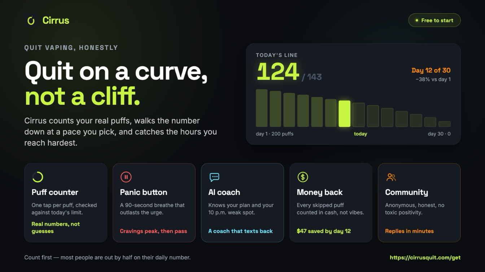

Ask a vape shop and you'll hear "way safer than smoking". Ask a worried parent and you'll
hear "they've got lead in them now". Both can point at a real study.

What neither says is that the question only has an answer once you say what you'd be doing
instead. There are three honest versions, and they come out differently.

## The short answer

If you smoke and you switch completely, vaping is a lot less harmful. Not harmless. Less.

If you've never smoked, your comparison isn't with cigarettes, it's with nothing. Against
nothing, vaping is all cost.

If you do both, you've picked the one combination with no measured upside.

That's the whole post. The rest is the numbers.

## What burning does

A cigarette is a small fire, and the fire is the problem. Tobacco smoke carries more than
7,000 chemicals. At least 250 are known to be harmful and at least 69 cause cancer. Tobacco
kills more than 7 million people a year.

A vape doesn't burn anything. It heats a liquid, so there's no tar and no carbon monoxide,
and those two do most of the damage in smoke. There's still nicotine, and it's still what
keeps you coming back. But nicotine isn't what gives you cancer. The burning is.

Two big reviews say the same thing. The US National Academies found "conclusive evidence"
in 2018 that switching completely from cigarettes to vaping cuts your exposure to the
toxicants and carcinogens in smoke. The UK's 2022 review, led by King's College London, put
it in one line:

> In the short and medium term, vaping poses a small fraction of the risks of smoking.
>
> <cite>Office for Health Improvement and Disparities, Nicotine vaping in England, 2022</cite>

It's also a way out. Cochrane's living review, updated in November 2025, rates it
high-certainty that nicotine vapes help more smokers quit for six months or more than
patches or gum: 9 in 100 against 6.

## Where vaping is worse

Now the part the shop leaves out.

**Metals.** In 2025 a UC Davis team ran disposables through a mass spectrometer. One
released more lead in a single day of use than roughly 20 packs of cigarettes. We ranked
[which vapes come out worst](/blog/most-dangerous-vapes-ranked-2026).

**Dose.** A Geek Bar Pulse is 16ml of liquid at 5% nicotine, which is about 800mg in your
pocket, somewhere between 300 and 500 cigarettes once you adjust for what your body takes
in. Nobody smokes in a meeting. People vape in them, and the day's total
[runs far past what you'd guess](/blog/how-many-puffs-in-a-disposable-vape).

**Lungs and blood pressure.** A 2025 Johns Hopkins analysis followed about 250,000 US adults
for four years. People who only vaped had 2.29 times the rate of COPD of people who used
neither, and among 30 to 70 year olds, a 39% higher rate of high blood pressure. Smokers were
worse on both, but "better than smokers" isn't "fine".

**The long term.** Nobody has it. The UK review said its evidence stops at the medium term.
A 2024 study in Cancer Research found vapers who'd smoked fewer than 100 cigarettes in their
lives had some of the same DNA changes in their cheek cells as smokers, changes that in
smokers predict lung cancer years out. The authors were careful: that isn't proof vaping
causes cancer. It's a reason nobody serious will tell you it doesn't.

## Doing both is the worst of it

Vaping where you can't smoke and smoking where you can feels like cutting down. The heart
data says it isn't.

In 24,000 US adults followed from 2013 to 2019, people who smoked and vaped were no less
likely to have a heart attack, stroke or heart failure than people who only smoked.

So if you've swapped half your cigarettes for a vape, the honest score is: still smoking.

## Two myths, quickly

**"Vaping gives you popcorn lung."** No. It came from factory workers breathing a flavouring
called diacetyl. There's never been a confirmed case from vaping, diacetyl is banned in UK
and EU vapes, and cigarette smoke has it anyway.

**"Vaping killed 68 people in 2019."** That outbreak was real: 2,807 people in hospital or
dead, 68 of them deaths. But 82% had been using THC cartridges, and 48 of the 51 patients
whose lung fluid was tested had vitamin E acetate in it, a cutting agent from the illicit
cannabis market, not anything in a nicotine vape.

Both get repeated because they fit on a poster. The real answer doesn't.

## So, is vaping worse than smoking?

Pick your line.

**You smoke.** Switch completely. Then treat the vape as a bridge, not a home.

**You smoke and vape.** You're not cutting down. Pick one, and let it be the vape.

**You never smoked.** Probably you, if you found this page. In 2021, most US vapers aged 18
to 24 had never smoked a cigarette. For you, "better than smoking" compares against
something you were never going to do. The real comparison is with nothing, and nothing is
winning.

## Where Cirrus fits

<figure>

<figcaption>Illustration only. The card shows a taper. The app runs cold turkey too.</figcaption>
</figure>

Full disclosure: [Cirrus](/) is our app, built for the people on the last two lines who want
out:

- It counts what you actually take, so your starting number is real, not a guess.
- It steps that number down on a curve, so you never meet the full drop at once.
- When a craving hits, there's a panic button and a breathing pacer for the fifteen to twenty
  minutes it lasts.

One honest caveat: the evidence for quitting vaping is thinner than for quitting smoking
(Cochrane calls it promising, low-certainty), so talk to a doctor or pharmacist about the
medication half. Cirrus handles the counting.

**[Get Cirrus, free to start](/download)**, on iPhone or Android.

## The bottom line

Less harmful than smoking if you switch, worse than nothing if you never smoked, no better if
you do both. And nobody has the long-term data, whatever they tell you.

The people who'll know for sure what twenty years of vaping does are the people who vape for
twenty years. You don't have to be one of them.
