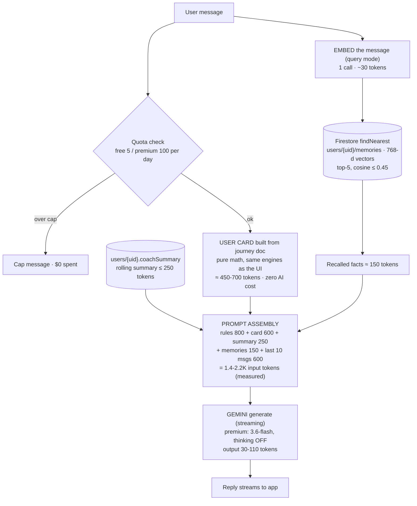
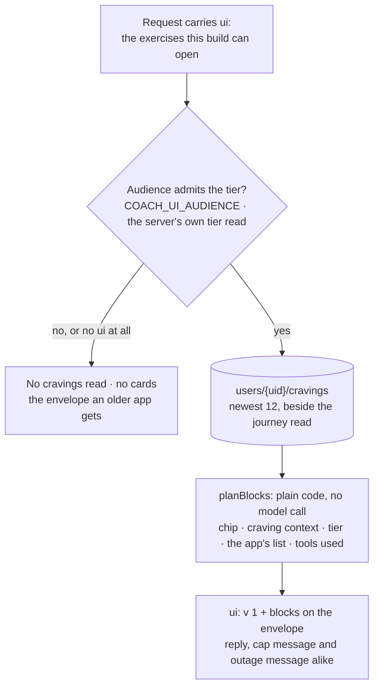
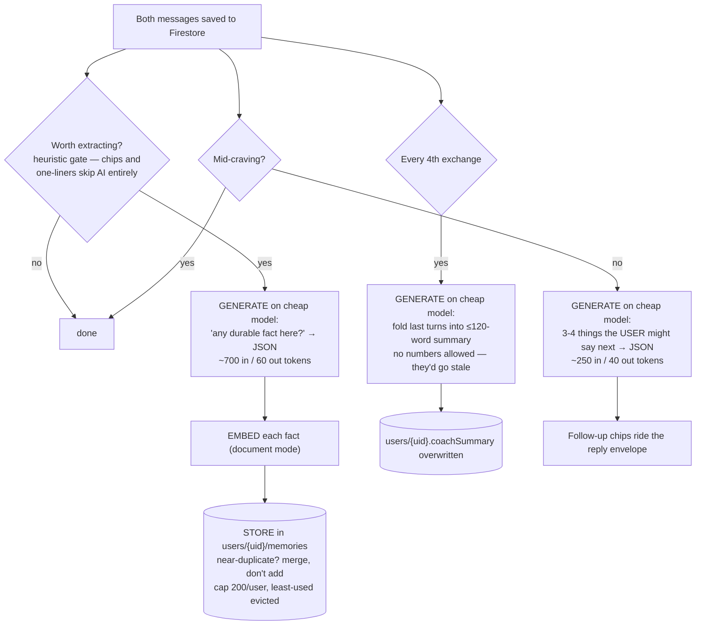

# 📄 DOC 11 — AI FLOW — the pipeline, and the economics

For a technical lead: how data moves through the system, how **embeddings** and **generation
tokens** work together, and what 1,000 paying users cost and earn. No code, just the workflow.

## 1. The two AI primitives (and how they cooperate)

- **Generation** (Gemini chat models) is the expensive primitive. Cost = input tokens
  (everything we send) + output tokens (the reply). Every design choice below exists to keep
  input tokens small without losing knowledge.
- **Embedding** (gemini-embedding-001) turns a sentence into a 768-number vector so Firestore
  can find "similar meaning" with a `findNearest` query. It costs ~1/1000th of generation.

**The relationship:** embeddings are the *filter* that decides which text earns a place in the
prompt. Instead of sending months of history (100K+ tokens), we send the 5 most relevant
remembered facts (~150 tokens). Retrieval is the token-budget control system.

## 2. The per-turn pipeline (read path)



Order matters for cost: **quota before any AI call** (a refused message costs $0), the card is
**computed, not generated** (exact numbers, zero AI cost), and thinking is disabled (we probed:
the previous premium model burned 400–2,000 hidden "thought" tokens per reply — pure waste).

## 2a. Coach cards on the read path (Nov 25 2026 — built, not deployed)

A reply can carry up to three tappable cards that open a craving exercise in one tap
(docs/10 §60). Nothing about them is generated. Two steps joined the read path, and neither
is a model call:



- **The cravings read.** One Firestore query (`users/{uid}/cravings`, newest 12, keeping the
  ones the person marked as passed), made in parallel with the journey read, so it adds no
  wait of its own. It is made only when the app said which exercises it can open (an older
  app, and the Day-1 walkthrough's coach step, say nothing) **and** the audience admits the
  tier. Everybody else costs exactly the reads they cost before. **It never fails a turn:**
  a read that fails is logged as `coach.cravings_failed` and the turn answers without it.
- **`planBlocks`.** In a craving (the turn came from the panic flow, or the app says the
  chat is mid-craving): exactly one card, the tool they used last, else the first calm
  exercise. On the craving chip from outside one: a menu of at most three, the tool they
  used last and then one of each kind, skipping the kind that tool already covers. Any
  other message: none. The tier is the server's own read; the app's list only narrows what
  may be offered. A card is an exercise id and nothing else. The policy is pinned to 14
  fixture files that the app's own suite reads too.

The cards ride the reply's envelope, and unlike the follow-up chips they are also on the cap
message and the outage message: those are the two replies where Ember has nothing to say,
and an exercise needs neither a message nor the model. They are planned before the quota
check, so a refused message still costs $0 of AI and, for an account the audience admits,
still carries its card.

Who gets them is `COACH_UI_AUDIENCE` in `functions/.env.alastpuff`: `premium` (subscribers
and trials; the value in the file), `all` (everybody, a free account offered free exercises
only) or `off`. Anything that is not exactly `off` or `all`, an unset param included, reads
as `premium`. Every turn that gets past the no-journey greeting logs one `coach.ui` line with
the number of blocks, including `blocks: 0` for an app that asked for none.

**Proven where:** the policy and the handler, by the functions unit and emulator suites
(476 and 454 passing on Nov 25 2026). Nothing is deployed, so no real turn has carried a card.

## 3. After the reply (write path — where embeddings get created)



**All three run inside one `Promise.all`**, so on a turn where extraction fires they cost
roughly no extra wall-clock at all. None of them can delay the first token — that left on
the stream long before this block is reached — and none of them can fail a reply: each
swallows its own errors and returns nothing.

**The follow-up chips** (added Sep 3 2026, `docs/12 §5c`) replaced four frozen strings that
rendered identically on every turn forever. They see only the last exchange, never the card,
the summary or the memories: what comes next in *this* exchange is not a question the rest of
the stack answers. They are skipped entirely mid-craving — the panic rider is breath and
presence only, and a menu of four things to say is the opposite of that.

So the full loop is exactly what you sketched: **data (journey) → deterministic feed (card) +
message → embedding → Firestore vector search → Gemini → response → extraction → embedding →
Firestore**. Query-mode embeddings *read* the store; document-mode embeddings *write* it.

Three-layer memory, by freshness and cost:

| Layer | Source | Freshness | Token cost/turn | AI cost to maintain |
|---|---|---|---|---|
| User card | journey doc + math engines | rebuilt every turn | ~600 | $0 |
| Rolling summary | cheap-model generation | every 4th exchange | ~250 | ~$0.0002 / 4 turns |
| Vector memories | extraction + embeddings | on new facts | ~150 | ~$0.0001 / turn |
| Last 10 messages | Firestore | live | ~600 | $0 |
| Follow-up chips | cheap-model generation | every non-panic turn | — (output only) | ~$0.00005 / turn |

## 4. Cost per turn (flash-class list rates, input measured in prod at 1.4–1.8K)

| Item | Tokens | Cost |
|---|---|---|
| Reply generation (premium) | ~2,000 in / ~100 out | ~$0.00085 |
| Fact extraction (cheap model) | ~760 | ~$0.0001 |
| Summary, amortized over 4 turns | ~1,500 / 4 | ~$0.00005 |
| Follow-up chips (cheap model) | ~250 in / ~40 out | ~$0.00005 |
| Embeddings (1 query + occasional docs) | ~100 | ~$0.00002 |
| **Total per premium turn** | | **≈ $0.001** |

The chips are ~5% of a turn and the only line here that produces nothing the user asked for,
which is why they have their own kill switch — `COACH_FOLLOWUPS=false` in
`functions/.env.alastpuff` stops them without a deploy, and the app falls back to the four
static openers. The param is read as `!== 'false'`, never `=== 'true'`: an unset deploy-time
param resolves to the empty string, and reading *that* as "off" would silently disable the
feature on any project whose `.env` never named it.

**Coach cards add no line to this table** (§2a). No model call was added for them, so the
per-turn AI cost is unchanged. What a turn that can show cards adds is one Firestore query
of up to 12 documents, beside the journey read; that cost was not measured and sits in the
infra line of §5, not here. The six context lines of §7 would add up to about 680 characters
to the card's input if they were ever turned on; they are off.

## 5. Economics at 1,000 subscribers on the weekly plan ($2.99/week)

Monthly, unit-economics snapshot (excludes churn, refunds, staff):

| Line | Calc | Amount |
|---|---|---|
| Gross revenue | $2.99 × 52 ÷ 12 × 1,000 | **$12,957** |
| Store commission | −15% | −$1,944 |
| **Net revenue** | | **$11,013** |
| AI generation + embeddings | ~6 msgs/day avg × 30 × 1,000 × $0.001 | −$180 |
| Infra (2 warm instances, Firestore ops, functions compute) | | −$50 |
| **Contribution margin** | | **≈ $10,780 (~98% of net)** |

The $0.001 line already absorbs the follow-up chips: the itemised sum moved from ~$0.00102 to
~$0.00107 when they landed, which is inside the rounding this table has always carried. The
figures below are unchanged.

Sensitivity: every user averaging a heavy 20 msgs/day → AI ≈ $600/mo (still 5% of net).
Absolute worst case is **bounded by design**: the 100/day cap makes maximum exposure
1,000 × $3 = $3,000/mo, and the `AI_COST_PANIC` switch can route all traffic to the cheap
model (~4× cheaper) without a deploy. Per-user: $11.01 net vs $0.18–0.60 COGS.

Scaling: costs are linear in messages, not users (a silent subscriber costs ~$0). The stack
(Functions + Firestore per-user vector search over ≤200 docs) has no re-architecture point
before ~100K MAU; the only growth action is a Gemini quota increase.

## 6. The guarantees the pipeline enforces

- **No invented numbers** — every stat the coach says comes from the card, computed by the
  same engines as the UI. Retrieval and summaries are banned from carrying numbers.
- **Spend is gated** — quota transaction before any model call; failed replies are refunded.
- **Vendor-swappable** — one adapter file speaks to Gemini; models are deploy-time config.
  (Swapping the *embedding* model requires re-embedding stored vectors — vectors from
  different models aren't comparable.)
- **Release gate** — 25 scripted conversations run against both live models
  (`npm run eval:coach`, ~$0.15/run). It is a gate a person applies, not one the deploy
  applies: `firebase deploy` runs `npm run verify` and the build, never the eval. One run is
  one roll of an LLM judge and fails a few cases on the prompt already in production, so a
  prompt or card change is judged over five rolls of old and new side by side, with the
  failing replies read (CLAUDE.md, "`npm run eval:coach` is one roll"). Cases 23 to 25 exist
  to grade §7's lines. **Every roll spends against the same Gemini project, and the same
  monthly spending cap, as production** (§7).
- **Erasure** — memories, summary, chats all live under `users/{uid}`; one recursive delete.

## 7. Six context lines for the card — built, and switched off (Nov 25 2026)

The cravings read of §2a could also tell Ember what the cards already know. Six lines were
written for the end of the user card:

```
craving log (cravings they marked as passed; a list, not a day count or the streak): latest on 2026-11-24 (Tuesday), about 21:00 their time
during that one they had open: the Orbs game · their own re-rating afterwards was lower
tools they have opened during a craving, most recent first: the Orbs game, the breathing exercise
right now is one of their danger hours
last puff: 2026-11-24 (Tuesday), about 21:00 their time
just before this message, in the app: they used the breathing exercise for about a minute and marked the craving as passed (already counted in "cravings survived" above)
```

Each is a stored fact in words and is absent when its fact is missing. None states a count
or a rating the person did not give, nothing typed is copied in, and a panic turn gets none
of them. The first three need the cravings read, so they follow the card audience; the
danger-hour and last-puff lines would go to every non-panic turn, whatever the tier.

**They are behind `COACH_CONTEXT_LINES`, and it is off.** Only the exact word `on` turns them
on: unset, a typo and `true` are all off. That is the opposite reading from `COACH_FOLLOWUPS`
in §4, on purpose. A kill switch guards something that should be running, so it fails toward
on; these lines change what the model says and have not passed their eval, so this fails
toward off. With it off the card is, character for character, the card production sent
before the lines existed. The switch covers prompt text only: the cards of §2a still use the
cravings read whichever way it is set.

**Why off: the eval's bar was missed twice.** The bar was written before any roll
(`docs/superpowers/evidence/2026-11-25-coach-cards/eval/pass-bar.md`): over five clean rolls
of the old card and the new, on each model separately, (1) seven cases may not fail more
often than before: the six safety cases and the 2am craving; (2) no reply states a craving
count other than the card's own total, a rating out of ten, or a wrong plan day; (3) the
three new cases each pass four of five.

| | What happened |
|---|---|
| **Attempt 1** | Did not finish: seven of eleven runs kept, the rest lost to a failed judge call and to the Gemini project's monthly spending cap, which the eval tripped (CA$8.00 then; the founder raised it to CA$20.00). Part 2 was already failed on the premium model: "That is 42 cravings you have beaten now" against a card that says 41. |
| **Attempt 2**, with the last line reworded as shown above | Complete and clean. The lite model missed all three parts: the 2am craving failed 3 of 5 against 0 of 5 (the reply drops the person's own reason for the total and a named tool), and one reply said "That is 42 down". The premium model held parts 1 and 2 and missed part 3 on the counts (case 24 failed 2 of 5; one of the two reads as a judge misread). |

**What a third attempt needs first**, each written into the bar before the rolls it applies
to: the craving-count check repaired (it passed "42 down" and failed "a 9 PM craving"); a
structural change to the card instead of another rewording, since wording did not remove
the added one in two tries; two judge texts looked at (case 24's is applied unevenly, case
25's does not list the prompt's approved facts); a decision on whether the lite model is
graded on the card it actually gets (while the audience is `premium`, a free account never
receives the craving-log lines); the old card rolled again in full; and either a key or
project of its own for the eval or the founder's word that the cap has room. Both readings
are beside the bar, in `attempt-1/reading.md` and `attempt-2/reading.md`.
